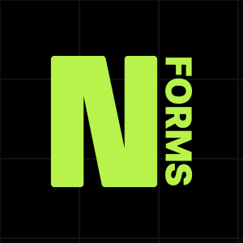

<p align="center">
  
</p>

# Nexley Forms

> **Ultra-Lightweight, Zero-Bloat WordPress Drag-and-Drop Form Builder & Submissions Engine.**  
> Engineered for radical frontend performance, SEO optimization, and visual sovereignty. Rivals Gravity Forms and Ninja Forms in features, while keeping frontend assets under strict performance budgets.

---

## Performance Budgets (Measured & Enforced)

Every frontend asset is strictly audited and automated in CI:

| Asset | Budget | Measured (Raw) | Measured (Gzip) | Utilization | Status |
| :--- | :--- | :--- | :--- | :--- | :--- |
| **Frontend Core JS Runtime** | < 2.0 KB | 4,899 B | **1,619 B** | 79.1% | **PASS** |
| **Conditional Logic Module** | < 1.5 KB | 3,301 B | **1,165 B** | 75.8% | **PASS** |
| **Multi-Step Wizard Module** | < 2.0 KB | 4,016 B | **1,221 B** | 59.6% | **PASS** |
| **Base Stylesheet CSS** | < 3.0 KB | 7,619 B | **2,053 B** | 66.8% | **PASS** |
| **DOM Element Budget** | ≤ 3 / field | — | **3 elements** | 100% | **PASS** |
| **Pages without forms** | 0 requests | 0 B | **0 requests** | 0.0% | **PASS** |

---

## Architectural Highlights

### 1. Single Source of Truth: JSON Schema v1
Forms are defined as standardized, portable JSON schemas. Every form stores its complete configuration (fields, layout, logic, notifications, webhooks) in a validated schema.

### 2. Zero Row/Column Wrapper Divs (Flat Sibling Grid)
- **Builder / Schema**: Models rows and columns in a 12-column coordinate system. Warns if a row's column spans do not sum to 12. Disallows nested columns.
- **Frontend Renderer**: Flattens fields into direct sibling children of the `<form>` element, each receiving an inline CSS custom property `--span: N`.
- **CSS Architecture & BEM Class Names**:
  - Wrapper: `.nexley-forms__group` (and `.nexley-forms__group--{type}`) ONLY. The 12-column grid CSS targets `.nexley-forms__group`.
  - Control: `.nexley-forms__field` and `.nexley-forms__control` ONLY.
  - Label: `.nexley-forms__label`.
  - DOM Budget: Exactly 3 DOM elements per standard field (`.nexley-forms__group` wrapper, `<label class="nexley-forms__label">`, and control `.nexley-forms__field .nexley-forms__control`) plus an optional hint/error element linked via `aria-describedby`.
- **Semantic Fieldsets**: Compound fields (e.g. Name, Address) and radio/checkbox groups use semantic `<fieldset>` and `<legend>` for WCAG AAA accessibility.

### 3. Dedicated Custom Database Table
- Submissions are stored in `{$wpdb->prefix}nexley_entries` rather than clogging the WordPress `wp_posts` and `wp_postmeta` tables.
- Composite index `(form_id, status, created_at)` for instant sub-millisecond queries on millions of entries.
- Idempotent migration engine with unique `legacy_post_id` preserves all historical CPT posts while moving active queries to the dedicated table.

### 4. Cache-Safe Submission Engine & Upload Hardening
- **Zero Public Nonces**: Form submissions do not use standard WordPress logged-out nonces that expire and cause cached page submissions to fail.
- **Honeypot Barrier**: Invisible honeypot field captures automated bots.
- **Client-Stamped Time-Trap**: Submission timestamp is stamped client-side upon user interaction (skips when JavaScript is disabled), avoiding cached server timestamp staleness. Rejects submissions faster than 3 seconds.
- **Transient IP Rate Limiting**: Exponential backoff prevents brute-force floods.
- **Out-of-Web-Root Uploads**: By default, uploads are stored outside the public document root (`app/nexley-forms-uploads`), completely preventing direct HTTP execution and access. Configurable via `nexley_forms_upload_dir`.
- **Fallback Protection**: When directory outside doc root cannot be created, falls back to `wp-content/uploads/nexley-forms` with an admin notice providing an Nginx configuration deny block (`location ^~ /wp-content/uploads/nexley-forms/ { deny all; return 404; }`) alongside `.htaccess` and `index.php`.
- **Authenticated Download Stream**: Uploaded files are served strictly via an authenticated endpoint (`admin-post.php?action=nexley_download_upload`) resolving by `entry_id` and `field_key` (no raw paths) and requiring `manage_options` (filterable via `nexley_forms_download_capability`).

### 5. Styling Sovereignty & Zero Specificity
- **Raw Mode**: Zero CSS enqueued. Your theme or Tailwind CSS rules form styling completely.
- **Base Mode**: Loaded inside `@layer nexley` with `:where()` selectors having 0-0-0 specificity. Theme styles always override cleanly without `!important`.
- **4 Design Presets**: Minimal, Rounded, Outlined, and High-Contrast Dark Mode.

### 6. Formula-Safe CSV Export (CWE-1236 Defense)
- Exported entries escape formula injection vectors (`=`, `+`, `-`, `@`, `\t`, `\r`) by prepending a single quote `'`.
- Streams large exports in batches with UTF-8 BOM (`\xEF\xBB\xBF`) so Microsoft Excel and Google Sheets render international characters without corruption.

---

## Third-Party Migration Adapters

Nexley Forms includes discovery cards and one-click import wizards:

| Source | Status | Features Supported |
| :--- | :--- | :--- |
| **Ninja Forms 3** | *Documented, unverified* | Reads `nf3_forms`, `nf3_fields`, `nf3_actions`, plus `nf3_form_meta`, `nf3_field_meta`, `nf3_action_meta` tables or `.nff` / `.json` export files. Converts fields, email actions, and success messages. |
| **Gravity Forms** | *Documented, unverified* | Reads `gf_form`, `gf_form_meta` or `.json` export files. Maps `layoutGridColumnSpan` (1-12) directly to Nexley 12-column layout. Converts notifications, confirmations, and choices. |
| **Contact Form 7** | *Direct source code inspected* | Reads `wpcf7_contact_form` posts, parses `[tag* name ...]` syntax, and converts `_mail` configurations into structured notifications. |

> *Note: Ninja Forms and Gravity Forms formats are labeled "Documented, unverified" based on documented schema specifications and sample fixtures.*

### Shortcode Replacer
Scans posts and pages for legacy shortcodes (`[ninja_form]`, `[gravityform]`, `[contact-form-7]`), generates dry-run diffs, and safely replaces them with `[nexley_form id="X"]`. All previous content is backed up in post meta with one-click rollback.

---

## Gutenberg Dynamic Block

- Registered server-rendered block: `nexley-forms/form-selector`.
- Real-time live preview inside the block editor using WordPress core `wp.serverSideRender`.
- Selector dropdown, title toggle, and style preset override in the block inspector.
- **Zero Frontend JS**: Renders server-side on frontend with 0 extra script tags.

---

## Action & Filter Hooks

### Action Hooks
- `nexley_forms_entry_created` `(int $entry_id, int $form_id, array $data)`: Fires immediately after an entry is saved to the custom DB table.
- `nexley_forms_entry_deleted` `(int $entry_id)`: Fires after an entry is permanently removed.
- `nexley_forms_webhook_dispatched` `(int $form_id, string $url, int $response_code)`: Fires after an outgoing webhook dispatch.

### Filter Hooks
- `nexley_forms_form_classes` `(array $classes, int $form_id, array $schema)`: Customize outer `<form>` CSS classes.
- `nexley_forms_allowed_html_tags` `(array $allowed_html)`: Filter `wp_kses` sanitization rules for HTML fields.
- `nexley_forms_anonymize_ip` `(bool $enabled, int $form_id)`: Override IP anonymization per form.
- `nexley_forms_mailer_headers` `(array $headers, array $notification, int $entry_id)`: Customize outgoing email headers.
- `nexley_forms_upload_dir` `(string $path)`: Customize absolute directory path for form uploads (defaults outside document root).
- `nexley_forms_download_capability` `(string $cap, int $entry_id, string $field_key)`: Filter required capability to download entry files (default `manage_options`).
- `nexley_forms_trusted_proxies` `(array $cidrs)`: Define trusted reverse proxy IP / CIDR ranges.
- `nexley_forms_trusted_proxy_header` `(string $header)`: Define header to inspect when behind trusted proxy (e.g. `HTTP_X_FORWARDED_FOR`, `HTTP_CF_CONNECTING_IP`).
- `nexley_forms_client_ip` `(string $ip)`: Filter resolved client IP address before rate limiting and logging.
- `nexley_forms_inline_base_css` `(bool $inline, int $form_id)`: Enable inlining the Base CSS stylesheet directly into `<style>` tag.

---

## Native .nex Envelope Specification

```json
{
  "format": "nexley-form",
  "schema": 1,
  "generator": "Nexley Forms 1.0.0",
  "exported_at": "2026-10-14T10:00:00Z",
  "form": {
    "title": "Contact Inquiry",
    "layout": { "columns": 12, "breakpoint": 640 },
    "fields": [
      {
        "id": "f_name",
        "name": "client_name",
        "label": "Full Name",
        "type": "text",
        "span": 6,
        "required": true
      }
    ],
    "rows": [
      {
        "id": "row_1",
        "columns": [
          { "id": "col_1", "span": 6, "fields": ["f_name"] }
        ]
      }
    ],
    "settings": {
      "style_mode": "preset",
      "preset": "rounded",
      "honeypot": true,
      "time_trap": true
    },
    "notifications": [],
    "confirmations": [],
    "webhooks": []
  }
}
```

---

## License

GPLv2 or later. Developed with pride by Nexley.
